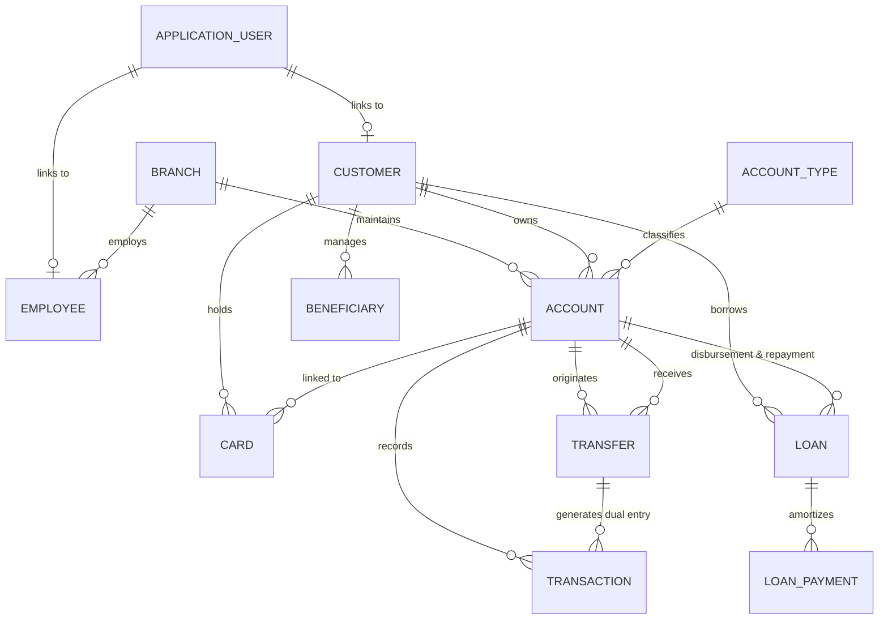

# SecureBank Core Enterprise &mdash; Banking Management System

[](https://dotnet.microsoft.com/)
[](https://learn.microsoft.com/aspnet/core/)
[](https://learn.microsoft.com/ef/core/)
[]()
[]()
[]()

> A production-grade, full-stack **Banking Management System** built with **C#, ASP.NET Core 8 MVC, Entity Framework Core, SQL Server**, and modern Razor UI. Designed specifically as a flagship software engineering / .NET portfolio showcase exhibiting enterprise architectural patterns, atomic ACID transaction processing with automated rollback, fine-grained Role-Based Access Control (RBAC), and persistent audit trails.

---

## Table of Contents

1. [Architectural Overview](#1-architectural-overview)
2. [Technology Stack](#2-technology-stack)
3. [Relational Database Design](#3-relational-database-design)
4. [Core Banking Modules & Functional Specs](#4-core-banking-modules--functional-specs)
5. [Transactional Integrity & Rollback Safeguards](#5-transactional-integrity--rollback-safeguards)
6. [Security & Regulatory Compliance](#6-security--regulatory-compliance)
7. [Pre-Configured Demo Credentials](#7-pre-configured-demo-credentials)
8. [Getting Started & Installation](#8-getting-started--installation)
9. [Automated Test Suite](#9-automated-test-suite)
10. [API & Controller Route Directory](#10-api--controller-route-directory)
11. [Git Commit History & Development Methodology](#11-git-commit-history--development-methodology)

---

## 1. Architectural Overview

The solution adheres to a **Clean 4-Layer Architecture** strictly decoupling presentation, application business logic, persistence, and unit testing:

```text
BankingManagementSystem/
│
├── BankingManagementSystem.sln             # Solution Configuration
├── BankingManagementSystem.slnx            # Modern .NET XML Solution File
│
├── BankingManagementSystem.Core/          # Domain Entities, Enums, DTOs & Contracts
│   ├── Constants/                         # System Constants, Prefix Formats & Roles
│   ├── DTOs/                              # Data Transfer Objects & Service Results
│   ├── Entities/                          # Domain Model POCOs (15 Normalized Entities)
│   ├── Enums/                             # Status & Transaction Types
│   └── Interfaces/                        # Service & Repository Abstractions
│
├── BankingManagementSystem.Infrastructure/# Data Persistence, Migrations & Services
│   ├── Data/                              # ApplicationDbContext, DbInitializer & Factories
│   ├── Migrations/                        # EF Core Code-First Database Migrations
│   ├── Repositories/                      # Generic & Specific EF Core Repositories
│   └── Services/                          # Atomic Domain Services Implementation
│
├── BankingManagementSystem.Web/           # ASP.NET Core 8 MVC Presentation Layer
│   ├── Controllers/                       # Thin MVC Action Controllers
│   ├── ViewModels/                        # Strongly Typed ViewModels with DataAnnotations
│   ├── Views/                             # Razor Views (.cshtml) with Tag Helpers
│   │   ├── Account/                       # Authentication, Login, Register, Password
│   │   ├── BankAccounts/                  # Account Opening, Portfolio & Statements
│   │   ├── Beneficiary/                   # Counterparty Beneficiary Management
│   │   ├── Card/                          # Debit & Credit Card Management
│   │   ├── Customer/                      # KYC Customer Onboarding & Profiles
│   │   ├── Dashboard/                     # Executive & Retail Customer Dashboards
│   │   ├── Home/                          # Public Portal Landing Page & Error Handlers
│   │   ├── Loan/                          # Loan Applications, Approvals & Repayments
│   │   ├── Notification/                  # Notification Bell & Alert Feeds
│   │   ├── Report/                        # Transaction, Customer, Loan, Daily Summaries
│   │   └── Transaction/                   # Cash Deposit, Withdrawal & Printable Receipts
│   └── wwwroot/                           # CSS (site.css), JS (site.js), Assets
│
└── BankingManagementSystem.Tests/         # Comprehensive Automated Test Suite
    └── Unit/                              # Unit Tests (Deposit, Withdrawal, Transfer Rollback, EMI)
```

### Request Processing Flow
$$\text{Razor View} \longleftrightarrow \text{Controller} \longleftrightarrow \text{Domain Service} \longleftrightarrow \text{UnitOfWork / Repository} \longleftrightarrow \text{SQL Server}$$

---

## 2. Technology Stack

### Backend
* **Language:** C# 12 (.NET 8.0 LTS)
* **Web Framework:** ASP.NET Core 8 MVC
* **ORM:** Entity Framework Core 8.0 with SQL Server Provider
* **Identity:** ASP.NET Core Identity with Secure Cookie Authentication
* **Database Engine:** Microsoft SQL Server / SQL Server Express (`BankingManagementDB`)
* **Testing:** xUnit, Moq, EF Core InMemory Provider

### Frontend
* **View Engine:** Strongly Typed Razor Views (`.cshtml`)
* **Styling:** Custom Enterprise CSS (`site.css`) paired with Bootstrap 5
* **Typography:** Inter Font & JetBrains Mono for monetary/account digits
* **Iconography:** Font Awesome 6 Pro Free CDN
* **Data Visualization:** Chart.js 4.4 interactive bar, line, and doughnut charts
* **Client Validation:** jQuery 3.7, jQuery Validation, Microsoft Unobtrusive Validation

---

## 3. Relational Database Design

The normalized relational database consists of **15 entities** with enforced primary keys, unique candidate keys, foreign key constraints, decimal precision (`decimal(18,2)`), non-clustered performance indexes, and optimistic concurrency tokens:



### Table Definitions

| Table | Primary Key | Key Foreign Keys & Unique Constraints | Key Purpose |
|---|---|---|---|
| `AspNetUsers` | `Id` (string) | Unique Email & NormalizedUserName | ASP.NET Core Identity authentication |
| `AspNetRoles` | `Id` (string) | Unique Name (`Admin`, `Employee`, `Customer`) | Role-based authorization |
| `Customers` | `CustomerId` (int) | Unique `CustomerCode`, Unique `Email`, Unique `NID` | KYC customer master record |
| `Branches` | `BranchId` (int) | Unique `BranchCode` | Bank branches and clearing routing numbers |
| `AccountTypes` | `AccountTypeId` (int) | Unique `Code` (`SAVINGS`, `CURRENT`, `SALARY`) | Interest rates, min balances, daily limits |
| `Accounts` | `AccountId` (int) | Unique `AccountNumber`, FK `CustomerId`, FK `AccountTypeId` | Customer deposit ledgers with concurrency RowVersion |
| `Transactions` | `TransactionId` (bigint) | Unique `TransactionReference`, FK `AccountId` | Immutable ledger of financial movements |
| `Transfers` | `TransferId` (bigint) | Unique `TransferReference`, FK `SenderAccountId`, FK `ReceiverAccountId` | Inter-account fund transfers |
| `Beneficiaries`| `BeneficiaryId` (int) | FK `CustomerId` | Customer saved counterparties & payees |
| `Cards` | `CardId` (int) | FK `CustomerId`, FK `AccountId` | Debit/credit card records with masked numbers |
| `Loans` | `LoanId` (int) | Unique `LoanNumber`, FK `CustomerId`, FK `AccountId` | Credit facilities, principal, interest, status |
| `LoanPayments` | `PaymentId` (bigint) | FK `LoanId` | Amortization installments, principal vs interest |
| `Employees` | `EmployeeId` (int) | Unique `EmployeeCode`, FK `UserId`, FK `BranchId` | Bank officer profiles and assignments |
| `AuditLogs` | `AuditLogId` (bigint)| Indexed `CreatedAt`, `Action`, `UserId` | Security, operational & compliance audit trails |
| `Notifications`| `NotificationId` (bigint)| Indexed `UserId`, `IsRead` | Real-time user transactional notifications |

---

## 4. Core Banking Modules & Functional Specs

### 1. Customer Management (KYC)
- Automated customer code generation (format: `CUST-10001`).
- Strict unique email and National ID / Passport validation.
- Profile dashboard displaying linked accounts, active credit facilities, debit cards, and registered beneficiaries.
- Operational status toggling (`Active`, `Inactive`, `Suspended`).

### 2. Bank Accounts
- Supported account categories: **Savings Account** (4.5% interest, $100 min balance), **Current Account** (1.0% interest, $500 min balance), and **Salary Account** (3.5% interest, $0 min balance).
- Automated unique account numbers (format: `BD-BNK-10000001`).
- Initial deposit validation ensuring compliance with account type minimum thresholds.
- Official printable **Statement of Account** with custom date-range filtering, inflow/outflow balance delta, and running ledger.

### 3. Cash Deposits & Teller Desk
- Real-time crediting of target accounts within an atomic database transaction.
- Dynamic quick-select chips ($500, $1,000, $2,500, $5,000).
- Immediate generation of official printable transaction voucher with unique reference `TXN-yyyyMMdd-000001`.

### 4. Cash Withdrawals
- Hard validation preventing withdrawal greater than available balance.
- Enforced minimum balance threshold (withdrawal denied if post-balance drops below minimum required).
- Enforced daily withdrawal limit against all transactions executed on the same calendar day.

### 5. Fund Transfers (ACID Dual-Entry)
- Real-time AJAX validation of destination accounts (dynamically renders beneficiary full name, branch, and account tier prior to confirmation).
- Strict non-identity rule preventing transfers between identical accounts.
- Dual-entry booking: atomically debits sender (`TRANSFER_OUT`), credits receiver (`TRANSFER_IN`), records `Transfer` entity, and creates an audit trail entry.

### 6. Loans & Credit Facilities
- Real-time actuarial EMI calculation:
  $$\text{EMI} = \frac{P \times r \times (1 + r)^n}{(1 + r)^n - 1}$$
- Live frontend repayment estimator recalculating monthly payment, total interest, and total repayment dynamically.
- Administrative approval workflow: automatically disburses loan principal into the customer's linked bank account atomically upon approval.
- Loan repayment module automatically amortizing outstanding debt, updating running balances, and splitting principal vs interest portions.

### 7. Cards & PCI-DSS Safety
- Automated issuance of Debit cards linked to active accounts.
- Masked card number display (`4532 **** **** 8821`) ensuring zero plain-text PAN exposure.
- Administrative and customer card locking/blocking controls.

### 8. Executive & Customer Dashboards
- **Executive Dashboard (Admin/Employee):** Real-time aggregate KPIs (Total Customers, Accounts, Active Portfolio, Gross Deposits, Gross Withdrawals, Gross Transfers, Loan Disbursements).
- **Interactive Chart.js Visualizations:** Past 6 months cash-flow trends (Deposits vs Withdrawals bar chart) and account tier distribution doughnut charts.
- **Customer Dashboard:** Real-time net liquidity balance, active card widgets, loan amortizations, and recent account activity ledger.

### 9. Financial Reports & CSV Export
- Daily Banking Summary report with selectable calendar dates.
- Filterable Transaction Ledger report with 1-click **Export to CSV**.
- Customer Portfolio and Loan Reports with print-optimized styling (`@media print`).

### 10. Audit Logging
- Immutable system audit trail capturing user IDs, timestamps (UTC), target entity names, IDs, action descriptions, and client IP addresses.

---

## 5. Transactional Integrity & Rollback Safeguards

Financial correctness is non-negotiable. Every state-altering financial workflow utilizes `IUnitOfWork` wrapping Entity Framework Core database transactions:

```csharp
await _unitOfWork.BeginTransactionAsync(cancellationToken);
try
{
    // 1. Deduct sender balance
    senderAccount.Balance -= amount;
    _accountRepository.Update(senderAccount);

    // 2. Add receiver balance
    receiverAccount.Balance += amount;
    _accountRepository.Update(receiverAccount);

    // 3. Insert Transfer & Dual Transaction entities
    await _transferRepository.AddAsync(transfer, cancellationToken);
    await _transactionRepository.AddAsync(debitTxn, cancellationToken);
    await _transactionRepository.AddAsync(creditTxn, cancellationToken);

    // 4. Save and commit atomically
    await _unitOfWork.CommitTransactionAsync(cancellationToken);
    return ServiceResult<Transfer>.Ok(transfer);
}
catch (Exception ex)
{
    // ROLLBACK EVERYTHING ON ANY FAILURE
    await _unitOfWork.RollbackTransactionAsync(cancellationToken);
    return ServiceResult<Transfer>.Failed($"Transfer failed: {ex.Message}");
}
```

---

## 6. Security & Regulatory Compliance

* **ASP.NET Core Identity:** PBKDF2 password hashing with HMAC-SHA256, salted unique hashes.
* **Role-Based Authorization:** Controller and action level `[Authorize(Roles = "...")]` restricting administrative access to vetted personnel.
* **Data Isolation:** Customer role accounts can only query and execute operations over accounts, cards, loans, and statements belonging to their own `CustomerId`.
* **CSRF Protection:** `@Html.AntiForgeryToken()` and `[ValidateAntiForgeryToken]` enforced across all state-modifying POST actions.
* **SQL Injection Immunity:** All relational operations executed through parameterized LINQ / EF Core queries.
* **Sanitized Secrets:** No database credentials or user secrets stored in public source code repositories.

---

## 7. Pre-Configured Demo Credentials

For demonstration, portfolio review, and evaluation, the database auto-seeds the following verified test accounts:

| Role | Email Address | Password | Clearances & Permissions |
|---|---|---|---|
| **System Administrator** | `admin@bank.com` | `Admin@123` | Full administrative clearances, loan approvals, reports, audit trail |
| **Branch Manager** | `manager@bank.com` | `Employee@123` | Customer onboarding, account opening, teller deposits/withdrawals, reports |
| **Bank Teller** | `teller@bank.com` | `Employee@123` | Counter deposits, withdrawals, customer inquiries |
| **Retail Customer 1** | `customer1@bank.com` | `Customer@123` | Jonathan Reynolds: Savings & Current Accounts, Active Loan, Debit Card |
| **Retail Customer 2** | `customer2@bank.com` | `Customer@123` | Eleanor Vance: Online transfers, statements, saved beneficiaries |
| **Retail Customer 3** | `customer3@bank.com` | `Customer@123` | Alexander Wright: Active accounts, pending mortgage loan application |
| **Retail Customer 4** | `customer4@bank.com` | `Customer@123` | Sophia Martinez: Portfolio management, debit card controls |
| **Retail Customer 5** | `customer5@bank.com` | `Customer@123` | David K. Sterling: High net-worth savings & current accounts |

---

## 8. Getting Started & Installation

### Prerequisites
* [.NET 8.0 SDK](https://dotnet.microsoft.com/download/dotnet/8.0) or higher
* [Microsoft SQL Server](https://www.microsoft.com/sql-server/) or SQL Server Express (running locally)
* Visual Studio 2022 (v17.8+), VS Code with C# Dev Kit, or JetBrains Rider

### Step 1: Clone the Repository
```bash
git clone https://github.com/YourUsername/Banking-Management-System.git
cd Banking-Management-System
```

### Step 2: Configure Database Connection
Review `BankingManagementSystem.Web/appsettings.json` to verify the SQL Server instance:
```json
{
  "ConnectionStrings": {
    "DefaultConnection": "Server=.\\SQLEXPRESS;Database=BankingManagementDB;Trusted_Connection=True;MultipleActiveResultSets=true;TrustServerCertificate=True"
  }
}
```

### Step 3: Run Database Migrations
Open your terminal in the solution directory and apply the EF Core migrations:
```bash
dotnet ef database update --project BankingManagementSystem.Infrastructure --startup-project BankingManagementSystem.Web
```

### Step 4: Run the Application
Launch the web server:
```bash
dotnet run --project BankingManagementSystem.Web
```

The application will start, automatically run seed scripts (creating branches, demo accounts, transactions, and credentials), and begin listening on:
```text
http://localhost:5000 (or assigned local port, e.g. http://localhost:5076)
```

---

## 9. Automated Test Suite

The solution includes automated unit tests covering financial rules, balance limits, EMI math, and transaction rollbacks:

```bash
dotnet test BankingManagementSystem.Tests/BankingManagementSystem.Tests.csproj
```

### Test Coverage Highlights
* `DepositAsync_PositiveAmount_IncreasesBalanceAndSucceeds`
* `DepositAsync_ZeroOrNegativeAmount_ReturnsFailedResult`
* `WithdrawAsync_SufficientFunds_DecreasesBalanceAndSucceeds`
* `WithdrawAsync_AmountGreaterThanBalance_ReturnsInsufficientFunds`
* `WithdrawAsync_ViolatesMinimumBalance_ReturnsError`
* `WithdrawAsync_ExceedsDailyLimit_ReturnsError`
* `TransferFundsAsync_ValidRequest_UpdatesBalancesAndCommitsTransaction`
* `TransferFundsAsync_SameAccount_FailsValidation`
* `TransferFundsAsync_InsufficientSenderFunds_FailsValidation`
* `TransferFundsAsync_ExceptionDuringSave_RollsBackTransaction`
* `CalculateMonthlyPayment_ValidParameters_ComputesCorrectEMI`
* `CalculateMonthlyPayment_ZeroInterest_DividesEvenly`
* `ApproveLoanAsync_PendingLoan_DisbursesFundsToCustomerAccount`
* `PayLoanInstallmentAsync_ValidAmount_DeductsFromAccountAndReducesRemainingBalance`

---

## 10. API & Controller Route Directory

| Route | Method | Authorized Roles | Description |
|---|---|---|---|
| `/` | GET | Anonymous | Executive landing page with highlights and demo credentials |
| `/Account/Login` | GET/POST | Anonymous | Authenticates users and establishes cookie sessions |
| `/Account/Register` | GET/POST | Anonymous | Retail customer self-onboarding |
| `/Account/Logout` | POST | Authorized | Terminates session and logs audit event |
| `/Dashboard/Index` | GET | All Authenticated | Dynamically routes to Admin or Customer dashboard |
| `/Dashboard/GetChartData` | GET | Admin, Employee | JSON endpoint for live Chart.js rendering |
| `/Customer/Index` | GET | Admin, Employee | Search, filter, and paginate customer records |
| `/Customer/Create` | GET/POST | Admin, Employee | Registers KYC customer profile with optional login credentials |
| `/Customer/Details/{id}` | GET | All (Scoped) | Comprehensive customer dossier |
| `/BankAccounts/Index` | GET | All (Scoped) | Bank accounts list and liquidity balances |
| `/BankAccounts/Create` | GET/POST | Admin, Employee | Opens new savings, current, or salary accounts |
| `/BankAccounts/Statement/{id}` | GET | All (Scoped) | Generates official printable statement of account |
| `/Transaction/Deposit` | GET/POST | Admin, Employee | Processes atomic cash deposits |
| `/Transaction/Withdraw` | GET/POST | Admin, Employee | Processes validated cash withdrawals |
| `/Transaction/Receipt` | GET | All (Scoped) | Displays official printable transaction receipt voucher |
| `/Transfer/Index` | GET/POST | All Authenticated | Inter-account fund transfer with atomic rollback |
| `/Transfer/LookupAccount` | GET | All Authenticated | AJAX endpoint returning account holder details by number |
| `/Loan/Apply` | GET/POST | All Authenticated | Applies for credit facility with live EMI calculator |
| `/Loan/CalculateEmi` | GET | All Authenticated | AJAX mathematical EMI calculation API |
| `/Loan/Approve/{id}` | POST | Admin | Approves loan and disburses principal to account |
| `/Loan/Pay/{id}` | GET/POST | All (Scoped) | Deducts repayment installment from customer balance |
| `/Card/Index` | GET | All (Scoped) | Displays visual debit cards with mask protection |
| `/Report/Index` | GET | Admin, Employee | Consolidated daily banking summary report |
| `/Report/Transactions` | GET | Admin, Employee | Transaction audit report with CSV export |
| `/AuditLog/Index` | GET | Admin | System audit trail with action filtering and IP attribution |

---

## 11. Git Commit History & Development Methodology

The project was constructed following phased enterprise development milestones:

* `feat: initialize 4-layer .NET 8 solution and dependency wiring`
* `feat: create domain entities, enums, DTOs, and repository contracts`
* `feat: configure ApplicationDbContext with SQL Server and EF Core migrations`
* `feat: implement ASP.NET Core Identity authentication and role-based policies`
* `feat: implement Customer KYC onboarding, profiles, and state governance`
* `feat: implement Bank Account management with auto-generated numbering`
* `feat: implement atomic cash Deposit and Withdrawal modules with limit checks`
* `feat: implement ACID Fund Transfer with automated rollback on failure`
* `feat: implement Loan management with interactive EMI calculation and disbursements`
* `feat: implement Card management with PCI-DSS safe masking`
* `feat: build responsive Executive and Customer Dashboards with Chart.js`
* `feat: implement financial reporting suite with CSV export and print stylesheets`
* `feat: configure persistent system Audit Logging and notification feeds`
* `test: add unit test suite covering financial logic, rollbacks, and limits`
* `docs: add comprehensive project README and architecture documentation`

---

## License & Credits

Developed by an Aspiring Senior Software Engineer for .NET Enterprise Internships. Built using standard Microsoft patterns and practices.
